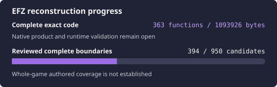

# Eternal Fighter Zero -Memorial-

<p align="center">
  
</p>

<p align="center">
  
</p>

Source reconstruction of the executable supplied in the Memorial archive.
The repository follows the organization and complete-function exact workflow
of the local TH10 reconstruction. [TH105](https://github.com/N0zoM1z0/th105)
is an engine-family research reference; its VC8 compiler and recovered layouts
are not EFZ evidence.

This is an initial reconstruction checkpoint, not a runnable replacement game.
See [progress](docs/PROGRESS.md) and the [current handoff](docs/RE_HANDOFF.md).

## Exact target

| Property | Locked value |
| --- | --- |
| Canonical private input | `resources/EFZ.exe` |
| Size | 3,743,744 bytes |
| SHA-256 | `3a1616d6c76d2eea08a95bb198d853e96cb6b9b3266e277ca1d167426dd66481` |
| MD5 | `9ac51d746d2ad288de8fe705e5b119c4` |
| Image base / entry | `0x00400000` / `0x00778A4A` |
| PE timestamp | 2005-11-25 04:56:47 UTC |
| Linker header | 7.10 |

Both archive members `EFZ.exe` and `EFZ/EFZ.exe` have this identity. `EFZ.OLD`
is different and is rejected. Archive labels and bundled readmes mix version
descriptions and modifications; official release provenance remains open. The
input is identified by its bytes, rather than an unverified version label.
See [target evidence](docs/KNOWLEDGE_BASE.md#target-identity).

## Current status

The initial checkpoint has **two complete exact functions, 434 code bytes**,
with all 20 relocation fields explicitly bound and compared. The local Ghidra
inventory contains 950 non-external candidates; their boundaries and origins
remain provisional until separately reviewed. [PROGRESS.md](docs/PROGRESS.md)
is generated from the live ledgers, and [the handoff](docs/RE_HANDOFF.md) records
the accepted configuration helpers, retained evidence and next owner.

Compiler, linker, resource and native execution smoke checks pass. The original
translation-unit graph, linked data/resources, full executable and runtime
comparison remain open. No whole-game completion percentage is claimed.

## Setup

Use CPython 3.13.5. The control plane, oracle and CI use the standard library.
The proprietary compiler, game files and analysis tools are not distributed.

```bash
uv venv --python 3.13.5 .venv
scripts/repo-python scripts/import-target.py /path/to/EFZ.exe
scripts/bootstrap-tools.sh \
  --msvc /path/to/msvc710 \
  --ghidra /path/to/ghidra_12.1.3_PUBLIC \
  --jdk /path/to/jdk-21.0.12.1+1
scripts/repo-python scripts/verify-target.py
scripts/repo-python scripts/verify-toolchain.py --execute
scripts/repo-python scripts/ci.py
```

The selected VC7.1 RTM compiler is **13.10.3077**, linker **7.10.3077**. This
matches the dominant Rich build records; it does not establish all original
compiler flags. Component, header and library identities are pinned separately.
Native jobs use a repository-owned win32 Wine prefix, Xvfb, one CPU, nice 10,
timeouts and retained exit logs. [Tool details](docs/TOOLS.md).

## Reconstruction loop

```bash
scripts/repo-python scripts/ghidra.py import
scripts/repo-python scripts/ghidra.py inventory
scripts/repo-python scripts/ghidra.py decompile 0x405A20
scripts/repo-python scripts/ghidra.py disasm 0x405A20
scripts/repo-python scripts/replay-exact-units.py \
  --unit config-read-byte --unit config-write-byte
scripts/repo-python scripts/validate-tracking.py --require-target
```

Import once; use `verify` for an existing project. Subsequent analysis queries
are read-only and do not rerun auto-analysis. The local wrapper checks the
imported target identity and all file-backed PE section bytes before queries.
Analysis and pseudocode remain provisional. Use Bash and this local Ghidra
workflow directly; REA is not part of this repository's workflow.

The exact oracle compares complete COFF function extents after replaying every
explicitly bound DIR32/REL32 field. It does not mask addresses or accept matching
prefixes. Normal COFF is supported initially; LTCG and linked EH/data closure
are open. [Oracle contract](docs/ORACLES.md), [workflow](docs/RE_WORKFLOW.md).

## Required phase order

1. Review EFZ boundaries/origins and recover complete exact VC7.1 authored units.
2. Close and exercise the faithful Windows i386 product, including data owners,
   initializers, resources, libraries and runtime scenarios.
3. Compare runtime semantics with two independent Oracles: the original target
   and the reconstructed native i386 product.
4. Begin portability after establishing a trustworthy native semantic baseline.

## Project map

| Path | Purpose |
| --- | --- |
| `config/` | target/tool locks, build recipes and independent progress ledgers |
| `src/` | handwritten natural C/C++ reconstruction |
| `probes/` | compiler/linker/resource smoke inputs |
| `scripts/` | verification, Ghidra, build, exact comparison and reporting |
| `docs/` | handoff, durable findings, workflow and comparison evidence |
| `resources/` | ignored read-only original executable |
| `.tools/` | ignored tool links and isolated Wine state |
| `.analysis/` | ignored logs, analysis exports and comparison reports |
| `_reference/` | ignored extraction of the supplied archive |
| `build/`, `ghidra-project/` | ignored products and local database |

## License

Repository-authored code and documentation are provided under the
[MIT License](LICENSE). This does not grant rights to the original game,
its assets or proprietary tools.
